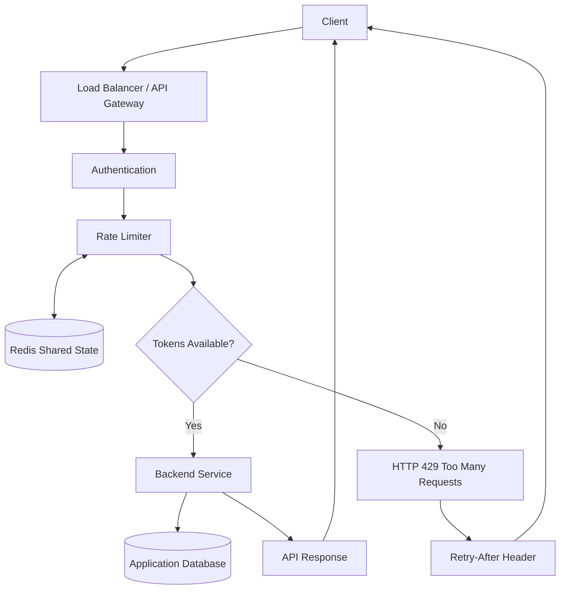

# Distributed API Rate Limiter

<p align="center">
  <strong>System Design Case Study</strong><br>
  Designing a scalable API rate limiter using the Token Bucket algorithm and Redis.
</p>

---

## 1. Overview

A rate limiter controls how frequently a client can access an API within a defined time period.

In a distributed application, multiple API servers may receive requests from the same client. A centralized rate-limiting mechanism is needed to ensure that request limits are consistently enforced across all servers.

This case study explores a Token Bucket-based design using Redis for shared state.

## 2. Problem

Consider an application receiving thousands of API requests every second.

Without rate limiting:

- A client can generate excessive traffic.
- Backend services can become overloaded.
- Infrastructure costs can increase.
- Legitimate users may experience degraded performance.

**Goal:** Protect backend services while allowing legitimate traffic to continue.

## 3. Requirements

### Functional

- Identify clients using API keys or user IDs.
- Configure limits for individual clients.
- Allow requests within the configured limit.
- Reject requests that exceed the limit.
- Return HTTP 429 with retry information.

### Non-functional

- Low request-processing latency.
- Horizontal scalability.
- Consistent decisions across application servers.
- Atomic updates to shared state.
- Resilience to infrastructure failures.

## 4. Architecture



### Component Responsibilities

| Component | Responsibility |
|---|---|
| Client | Sends API requests |
| API Gateway | Receives and routes requests |
| Authentication | Identifies the client |
| Rate Limiter | Applies rate-limit rules |
| Redis | Maintains shared token state |
| Backend Service | Processes accepted requests |
| Database | Stores application data |

## 5. Request Lifecycle

1. Client sends an API request.
2. API Gateway receives the request.
3. Authentication identifies the client.
4. Rate Limiter retrieves the client's bucket state.
5. Redis performs the shared-state update atomically.
6. If a token is available, one token is consumed and the request proceeds.
7. Otherwise, the request is rejected with HTTP 429.

## 6. Algorithm Selection

| Algorithm | Advantages | Limitations |
|---|---|---|
| Fixed Window | Simple and efficient | Boundary traffic bursts |
| Sliding Window Log | Accurate request tracking | Higher memory usage |
| Token Bucket | Supports controlled bursts | Requires token-state management |

### Selected: Token Bucket

The bucket stores a limited number of tokens.

- Tokens are replenished at a configured rate.
- Each accepted request consumes one token.
- Requests are rejected when no tokens remain.
- The bucket cannot exceed its maximum capacity.

## 7. Example Configuration

| Parameter | Value |
|---|---:|
| Bucket capacity | 10 tokens |
| Refill rate | 2 tokens/second |
| Request cost | 1 token |

A newly initialized bucket can accept 10 requests immediately. Afterward, tokens become available at a rate of 2 per second.

## 8. Redis Data Model

A unique key can represent each client's rate-limit state.

```text
rate_limit:user_123
```

Example state:

```text
tokens = 7
last_refill_timestamp = 1730000000
```

All application servers access the same logical state for a client.

**Concurrency requirement:** Token calculation, validation, and consumption must be atomic. Redis Lua scripting can execute these operations atomically.

## 9. API Response

### Accepted request

```http
HTTP/1.1 200 OK
```

### Rejected request

```http
HTTP/1.1 429 Too Many Requests
Retry-After: 2
Content-Type: application/json
```

```json
{
  "error": "rate_limit_exceeded",
  "message": "Too many requests. Please try again later."
}
```

## 10. Distributed System Challenges

### Shared State

Local counters on individual servers can produce inconsistent decisions. Redis provides shared state across application instances.

### Atomicity

Concurrent requests must not consume the same token. Redis Lua scripts can make the token-bucket operation atomic.

### Redis Availability

Two possible failure policies:

- **Fail-open:** Allow requests if Redis is unavailable.
- **Fail-closed:** Reject requests if Redis is unavailable.

The correct choice depends on the application's security and availability requirements.

### Horizontal Scaling

Additional application servers can be introduced as traffic increases. They continue using the shared Redis state.

## 11. Trade-offs

- Redis adds network latency to request processing.
- Redis availability affects rate-limit enforcement.
- Redis replication and failover need careful planning.
- A heavily used Redis deployment may become a bottleneck.
- Rate-limit policies must balance abuse prevention and user experience.

## 12. Implementation

| File | Purpose |
|---|---|
| `implementation/cpp/rate_limiter.cpp` | In-memory Token Bucket learning implementation |
| `implementation/redis/token_bucket.lua` | Atomic Redis Token Bucket operation |

The C++ implementation demonstrates the algorithm within a single process. It is not a distributed production implementation.

The Redis Lua implementation demonstrates how shared state can be updated atomically.

## 13. Future Improvements

- Per-user and per-endpoint rate limits.
- Subscription-based rate-limit policies.
- Monitoring and metrics.
- Redis Cluster and failover support.
- Concurrent request and load testing.
- Automated integration tests.

## 14. References

- [Redis Documentation](https://redis.io/docs/latest/)
- [Redis Lua Scripting](https://redis.io/docs/latest/develop/programmability/eval-intro/)
- [HTTP 429 - MDN](https://developer.mozilla.org/en-US/docs/Web/HTTP/Reference/Status/429)
- [System Design Primer](https://github.com/donnemartin/system-design-primer)

---

*This case study is an independent educational system design, not a description of any company's private implementation.*
